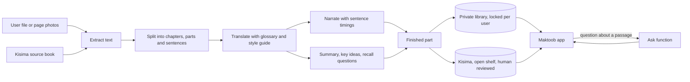

# Maktoob

**Kisima cha maarifa.**

> Status: project plan, updated 18 November 2026.
> This plan continues the Maktoob project started in May 2026 (Flutter app, Firebase project `maktoob-app`, repository `DrAlly05/maktoob`).
> Upload feature confirmed by Dr. Ally Said on 18 November 2026. Name Maktoob and app ID `com.lunomj.maktoob` confirmed on 19 November 2026.
> Lines marked **PROPOSED** wait for his confirmation. Lines marked **TO VERIFY** state something that must be checked before it is relied on.

---

## 1. What Maktoob is

Maktoob is a well of knowledge that anyone can draw from in the language they think in.

A person adds a book: a file they have, or a paper book photographed page by page. Maktoob turns it into Swahili text and a Swahili voice. They listen while washing dishes or walking home. When a passage is hard they tap it and ask, by typing or by speaking, "Hii inamaanisha nini kwangu?" The app answers in Swahili with an example from Tanzanian life and shows the passage it used.

Beside their own books sits the Kisima: a shelf of ready books that Maktoob has already prepared, open to everyone.

Swahili is the launch language. Nothing in the design assumes Swahili, so Arabic, Italian, German or any other language is a content job later, not a rebuild.

## 2. Who it is for

| Person | What they need | What Maktoob gives |
|---|---|---|
| Someone who never finished school and reads little | Knowledge without a reading barrier | Listening first, questions by voice, answers spoken aloud |
| A Swahili reader with weak English | Books that exist only in English | Full Swahili text and narration of any book they hold |
| A learner improving their English | Both languages together | Original sentence one tap away from the Swahili one |
| A busy person | Books during chores and travel | Background audio, downloads, exact resume |

## 3. What is possible and what is not

| Wanted | Verdict | Plain reason |
|---|---|---|
| Upload a book you have and read it in Swahili | Possible | Text is extracted, then translated part by part. |
| Photograph a paper book and do the same | Possible | The phone reads the text from each photo. A 250 page book is about 125 photos of open pages. |
| Listen to it in Swahili | Possible | Swahili AI voices exist. Which one sounds right is decided by a Tanzanian ear. |
| Highlight and ask "what does this mean in my context" | Possible | Needs internet. |
| Summaries and "tell it another way" | Possible | Made per chapter and stored. |
| Android and iOS together | Possible | One Flutter codebase, one version number. |
| Habit design that competes with social media | Possible | Section 6. |
| Open a book bought inside Kindle or Apple Books | Not possible | Those files are locked to their own apps. No outside app can open them. The paper copy through the camera works. So does any unlocked EPUB, PDF or text file. |
| Derek Perkins's voice | Not possible without his written consent | Voice providers refuse it. Maktoob's own signed narrator is the answer (section 4.3). |
| Asking questions with no internet | Not possible | The model runs in the cloud. Downloaded reading and listening work with no internet. |
| Poetry and verse translated well by machine alone | Weak | Plain prose is the strong case. |
| Local languages such as Sukuma or Makonde | Not reliable today | **TO VERIFY** per language. |

## 4. Where the books come from

### 4.1 Vitabu vyangu: your own books (core feature, on at launch)

Two ways in:

* **A file.** EPUB, PDF, Word or plain text.
* **The camera.** Photograph each open page of a paper book. The phone reads the text on the device.

What happens next:

* The book appears in the user's own library within a minute, with chapter list and original text.
* **Papo hapo (on the phone).** Translation and voice run on the phone itself. Ready at once, works with no internet, costs nothing per listen. The translation is rougher and the voice is the phone's own. The May 2026 code already does this.
* **Bora (in the cloud).** A better translation and a natural voice, made **part by part, as the user reaches them**, then kept. A user who stops at chapter two costs two chapters, not a whole book.
* The book belongs to that user's library only. One person's upload is never shown to another person. This is a design rule and a security rule: storage is locked per user.

### 4.2 Kisima: the open shelf

Ready books prepared in advance and open to every user from the first minute, so nobody opens an empty app. These are books that are free for everyone to use, plus any book whose author has agreed.

**PROPOSED** first twelve, each **TO VERIFY** before publishing:

1. *As a Man Thinketh*, James Allen (1903)
2. *The Science of Getting Rich*, Wallace Wattles (1910)
3. *The Richest Man in Babylon*, George Clason (1926)
4. *Think and Grow Rich*, Napoleon Hill (original 1937 edition)
5. *Acres of Diamonds*, Russell Conwell
6. *Up from Slavery*, Booker T. Washington (1901)
7. *The Autobiography of Benjamin Franklin*
8. *Self-Help*, Samuel Smiles (1859)
9. *Meditations*, Marcus Aurelius (old English translation)
10. *The Art of War*, Sun Tzu (Lionel Giles translation, 1910)
11. *The Prophet*, Kahlil Gibran (1923)
12. *Julius Caesar*, William Shakespeare (the verse test case)

Authors who want their book in the Kisima can offer it. An author who has gifted a book and believes knowledge should travel is the first person to ask.

### 4.3 The voice

| Option | Advantage | Disadvantage |
|---|---|---|
| Stock AI Swahili voice from a provider | Ready today | The same voice other apps use. Quality unknown until heard. |
| Maktoob's own narrator: a Tanzanian voice artist under contract, with a licensed AI copy of their voice | A signature voice nobody else has | A fee, a contract, a studio session |
| The phone's built-in voice | Costs nothing per listen, works with no internet | Sounds robotic. Swahili support on iPhone **TO VERIFY**. |
| Human narration of every book | Best quality | Slowest and most expensive. Cannot cover uploads at all. |

**PROPOSED:** the phone's voice for Papo hapo, the best stock voice chosen by ear test for Bora, signed narrator in parallel.

## 5. Features (everything here ships in the first public release)

### Add a book
* Upload a file or scan a paper book with the camera.
* Page photos are straightened and read on the phone. The user can fix a badly read page.
* Progress is shown honestly: "Sura ya 1 iko tayari. Nyingine zinaandaliwa."

### Read
* Full Swahili text, clean typography, night mode, large text mode.
* Parallel view: tap any sentence to see the original beside it.
* Tap a word for its meaning. Saved to a personal word list.

### Listen
* Swahili narration for every part.
* The sentence being spoken lights up on screen.
* Plays in the background and from the lock screen. Speed control, sleep timer, skip back 15 seconds.
* Resume at the exact sentence, on any device.
* Download parts over Wi-Fi. Roughly 11 to 15 MB per hour of audio (**estimate**).

### Understand
* Highlight a passage and choose: **Eleza** (explain it), **Mfano wa hapa kwetu** (a local example), **Fupisha** (make it shorter).
* Ask anything about the chapter by typing or by voice. The answer comes back in Swahili text and speech.
* Every answer shows the passage it came from. If the book does not say, the app says so.
* End of chapter: a short summary and "mambo matatu ya kubaki nayo".
* A report button on every AI answer.

### Keep going (section 6)
* Daily goal, streak, recall questions, quote cards, reading circles.

### Account and about
* A Kisima book plays before any sign-up.
* Sign in with Google, Apple or phone number to upload books, sync progress and ask questions.
* Interface in Swahili and English. Swahili strings reviewed by a native speaker. The app is called "app" in Swahili copy, not "programu".
* **About screen with founder credit:** "Imetengenezwa na Dkt. Ally Said", with links to his TikTok, Facebook, LinkedIn and website, and a row for the app's own social links.

## 6. Habit design

The mechanics below are the ones social apps use. The rule that keeps them honest: **every hook must end in minutes read or heard, never in empty scrolling.** There is no feed.

| Mechanic | How it works here |
|---|---|
| Instant reward | Narration starts within one tap of first opening the app. |
| Small sessions | Chapters are cut into 8 to 12 minute parts. Each part ends on an open question. |
| Next part pull | A five second countdown rolls into the next part. |
| Daily goal and streak | Goal set in minutes. One rest day a week does not break the streak. |
| Chosen moment | The user picks their chore time. One reminder a day, at that time. |
| Visible progress | A well that fills as the user learns. A count of ideas collected. |
| Recall | Next day: three quick questions on yesterday's ideas. |
| Sharing | One tap turns a highlighted line into a designed card for WhatsApp Status, carrying the app's name. The main growth loop. |
| Belonging | Reading circles (vikundi): a small group reads one Kisima book and sees each other's progress. No chat. |

## 7. How it is built

One pipeline, used two ways.

**The pipeline** takes a book in and produces Swahili text, audio with sentence timings, summaries and recall questions. For Kisima books it runs once, in full, with a human reviewer before publishing. For uploaded books it runs in the cloud, part by part, as the user listens.

**The app** adds books, plays finished parts and sends questions to one small cloud function.



Structural decisions:

* **Two quality levels, one reader.** Papo hapo runs on the phone at no cost. Bora runs in the cloud. The reader and the player do not care which one made a part.
* **Part by part, on demand.** Cost follows real listening.
* **Kept once made.** A finished part is never produced twice for the same user.
* **Private by default.** Uploaded books sit in storage that only their owner can read. Enforced by server rules, tested automatically.
* **No vector database.** Questions are answered from the current chapter plus the book summary.
* **A new language is a new run of the pipeline.** The app does not change.

## 8. Stack

| Layer | Choice | Why |
|---|---|---|
| App, Android and iOS | Flutter (Dart) | Same as Zero to Five. One codebase, same store accounts. |
| App state | provider | Already in the project. |
| On-device storage | SQLite through Drift | Progress, highlights and downloads survive with no internet. |
| Audio | just_audio with just_audio_background | Already in the project. Background and lock screen playback. |
| On-phone translation | Google ML Kit translation | Already in the project. No cost, no internet once the language pack is downloaded. |
| On-phone voice | flutter_tts | Already in the project. Uses the phone's own voices. |
| Opening book files | epubx for EPUB, Syncfusion viewer for PDF | Already in the project. Syncfusion licence terms **TO VERIFY**. |
| Reading text from page photos | Google ML Kit text recognition, on the phone | No cost per page, no upload of raw photos. Accuracy on curved pages **TO VERIFY**. |
| Sign-in, database, files, push, crash reports | Firebase (Auth, Firestore, Storage, Messaging, Crashlytics, App Check, Remote Config) | Project `maktoob-app` already exists. Which Google account owns it **TO VERIFY**. |
| Pipeline | Python on Cloud Run, started by an upload or by a listener reaching a new part | Same language as the existing content engines. |
| Ask function | Cloud Functions in Python | Two languages in the whole project: Dart and Python. |
| Translation and answers | Gemini on Vertex AI, Claude on Vertex AI tested beside it | Winner chosen by blind test on one chapter, judged by a native reader. |
| Narration | Decided by ear test | Candidates: Azure Tanzanian Swahili voices, ElevenLabs, Google's own speech models. A Google voice is paid by the existing credits. The others are paid in cash. |
| Website and legal pages | maktoob.lunomj.com on Netlify | Same pattern as zerotofive.lunomj.com. |

Users never see a stack. What they feel is a paper book turning into a voice, a sentence lighting up in time with that voice, and a tutor that answers in Swahili. The sophistication goes there. The plumbing stays plain on purpose.

## 9. Repository layout

```
maktoob/                  the existing Flutter project stays at the root
  README.md
  pubspec.yaml
  docs/
    decisions.md          one line per decision: date, decision, reason
    privacy/              policy and terms sources
  lib/
    core/
    features/add_book/
    features/library/
    features/book_reader/ exists today
    features/player/
    features/ask/
    features/habit/
    features/account/
  test/
  android/
  ios/
  pipeline/               Python: cloud translation and narration
    extract/
    split/
    translate/
    narrate/
    enrich/               summaries, key ideas, recall questions
    publish/
    tests/
  functions/              cloud functions (Python): ask, limits, reports
  content/
    kisima/               source list and status sheet per Kisima book
    glossary/sw.md        fixed Swahili choices for recurring terms
    style/sw.md           translation style guide
```

Book text and audio are never committed to the repository. They live in cloud storage.

## 10. Data sketch

* **Book**: id, title, author, source language, owner (a user, or "kisima").
* **Part**: ordered sentences, each with original text, translated text, start and end time in the audio. Status: waiting, ready, failed.
* **User progress**: book, part, sentence, minutes heard, streak.
* **Highlight**: sentence range, note, questions asked and answers given.
* **Circle**: members and each member's progress on one Kisima book. Nothing else.

## 11. Build order

One public release with everything in section 5. This is a sequence of work, not a set of versions.

1. **Bring the existing project to a clean state.** Save the uncommitted work, set one permanent app ID on Android and iOS, get the build passing, remove the empty files and the duplicate reader screen.
2. **Ear test and translation test.** One Swahili page through each candidate voice. One chapter through each translation model. Runs beside step 1.
3. **Pipeline, one finished book.** *As a Man Thinketh* from source to Swahili parts with timings, summary and questions.
4. **App core.** Library, reader, player, downloads, resume.
5. **Add a book.** File upload, camera scan, part by part processing, private storage rules.
6. **Ask.** Highlight actions, voice questions, source passages, limits, report button.
7. **Habit layer.** Goal, streak, recall, quote cards, circles.
8. **Accounts, about screen with founder credit, legal pages, store listings.**
9. **Quality gate.** Section 12.
10. **Fill the Kisima, then launch** on Android and iOS the same day, version 1.0.0 on both.

## 12. Quality, security, privacy

* **Private library test.** An automated test signs in as user A and proves user B's book cannot be read. Runs on every change to storage rules.
* **Kisima quality gate.** Every Kisima edition is read by a named human reviewer before it is published.
* **Uploaded books are labelled honestly.** "Imetafsiriwa na AI" on every machine translated part, so the listener knows no human has checked it.
* **Listening test.** Ten real listeners, at least three who did not finish school, each complete one chapter and answer three questions about it.
* **Automated tests.** Pipeline: extraction, sentence alignment and timing on every run. App: resume position, playback with no internet, sign-in, upload.
* **Secrets.** No model or voice keys inside the app. All paid calls go through the cloud, protected by App Check.
* **Limits.** Daily question limit and upload size limit per user, enforced on the server.
* **Privacy.** Voice questions are turned into text and the recording is discarded. Page photos are read on the phone and only the text is sent. Register the processing with the PDPC under Tanzania's Personal Data Protection Act.
* **Apple.** Offering Google sign-in means Sign in with Apple is required as well.
* **Backups.** Finished Kisima parts are the expensive asset. Keep a second copy outside the live bucket. Users can delete any uploaded book and everything made from it.
* **Accessibility.** Large text mode, full screen reader labels, every action reachable by voice or one thumb.
* **Monitoring.** Alert on pipeline failures and on daily AI spend passing a set ceiling.

## 13. Brand

**Name: Maktoob.** Arabic for "written" and for "it is written". The name this project has carried since May 2026.

**Line under the name:** Kisima cha maarifa. **PROPOSED.** The name is Arabic, so the Swahili line carries the meaning for a reader who has never met the word.

**Store title:** "Maktoob: Kisima cha Maarifa". **PROPOSED.**

Architect checks:

* **One year test.** Passes. Every book is something written, in any language.
* **Audience test.** The word is not Swahili. Many Tanzanians will not know it, so the line and the icon must explain the app on their own.
* **Spelling.** People who only hear the name may type Maktub or Maktoub. Add both as store keywords.
* **Earlier use.** Maktoob was a well known Arab web portal bought by Yahoo and closed in January 2023. Yahoo registered the name as a trademark in the United States. Whether that registration is still alive is **TO VERIFY** before the first store upload.
* **Store search.** One web search found no app called Maktoob on either store. Not a full check.
* **Permanence.** The Android package name and the iOS bundle ID can never change after first upload. Both are `com.lunomj.maktoob`, set on 19 November 2026 before any store upload. The Firebase apps still need registering again under this ID.
* **Consistency.** The repository sits under the personal account `DrAlly05`. The other products sit under `Luno-MJ-Tech`. **PROPOSED:** transfer it. History and commit credit are kept.

**Logo direction.** A well seen from above: rings of water spreading outward that read, at the same time, as sound waves leaving a voice. Warm earth and water colours, hand-drawn feel.

**How it sounds.** A single drop of water into a well when a book opens. A narrator voice that is unhurried and warm, standard Swahili, the voice of a trusted teacher.

## 14. What costs money

| Cost | When it is paid | How it is controlled |
|---|---|---|
| Translation | Per part, the first time a user reaches it | Small. Paid from cloud credits. |
| Narration | Per part, the first time a user reaches it | The largest cost in the project. A whole 60,000 word book is roughly 6 to 7 hours of audio (**estimate**). Provider prices **TO VERIFY**. Made only for parts actually reached. |
| Questions | Every time a user asks | Daily limit, plus stored answers for common highlights in Kisima books. |
| Audio downloads | Every download | Low bitrate files, Wi-Fi by default. |
| Narrator contract | Once | Unknown until a narrator is approached. |

Papo hapo costs nothing per listen, so every uploaded book has a zero cost path. Bora is where the money goes: cloud narration spend grows with every listener who uses it. Who gets Bora, and who pays for it, is the largest open decision in this file.

## 15. Open decisions

1. Who gets Bora and who pays for it: paid plan, sponsor, grant, a monthly allowance per user, or a mix.
2. Which voice passes the ear test.
3. Stock voice only, or a signed Tanzanian narrator as well.
4. The first twelve Kisima titles.
5. Who the human reviewer for Kisima editions is.
6. Which Google account owns the existing Firebase project `maktoob-app`, and whether it moves under the company account.
7. The app ID `com.lunomj.maktoob` and the repository transfer to `Luno-MJ-Tech`.
8. The line under the name.

---

Built by LUNO Mwanajando Technologies Co. Limited. Founder and developer: Dr. Ally Said.
